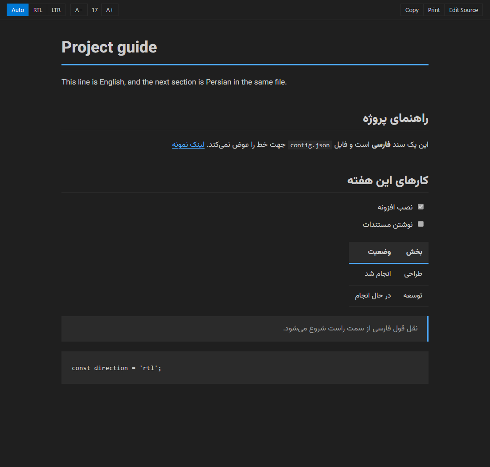

# MD Reader +RTL

Read Markdown as a clean page inside the editor, with automatic right-to-left for Persian and Arabic. By [HiT Land](https://hit.land).

Works in VS Code and in editors built on it, such as Antigravity and Cursor.

## What it does

- Opens `.md` and `.markdown` files as a formatted page in the editor tab.
- Sets the direction block by block, so Persian and English can share one document.
- Updates the page while the file changes.
- Takes its colours from your editor theme, including light, dark and high contrast themes.
- Works offline. The Vazirmatn font is included.

## Toolbar

| Button | Action |
|---|---|
| Auto / RTL / LTR | Automatic, right-to-left or left-to-right, saved per file |
| A− / A+ | Text size, 12 to 28 |
| Copy | Copy the selection or the whole page with formatting |
| Print | Open the page in the default browser and start printing |
| Edit Source | Open the Markdown source beside the page |

Diff views stay normal text diffs. To see a file as text, use **Edit Source** or **View: Reopen Editor With... > Text Editor**. To turn off opening in the reader, set `hitMdViewer.openByDefault` to `false`.

## License

Extension: [MIT](LICENSE), © High Tech Business Solutions LLC. The HiT logo in `media/icon.png` is a trademark of the company and is not covered by the MIT license. Font: Vazirmatn, SIL Open Font License (`media/fonts/OFL.txt`).
